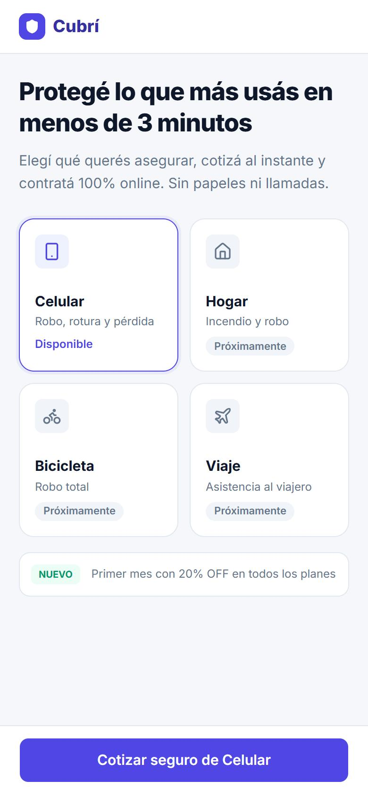
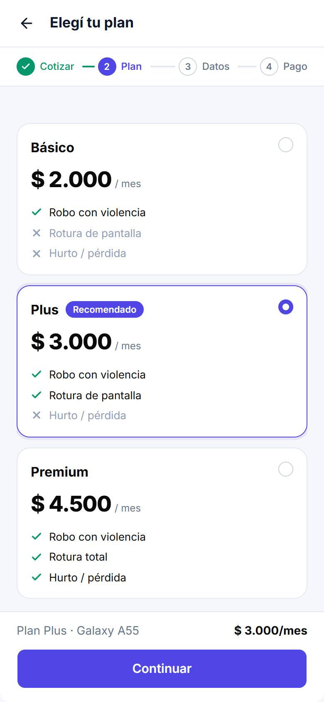
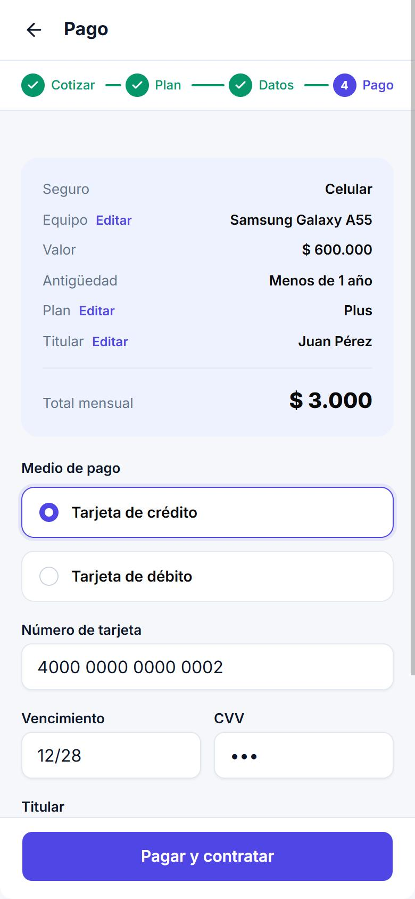
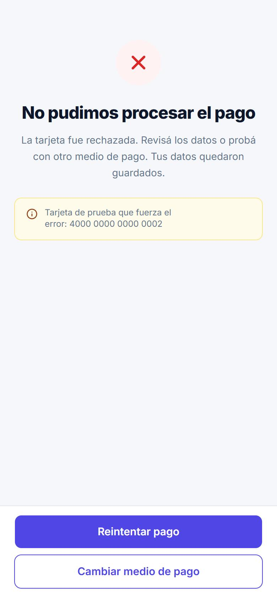
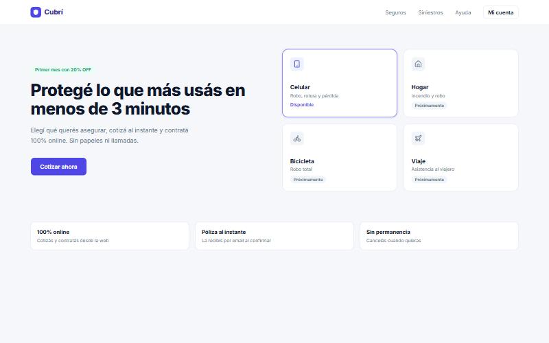
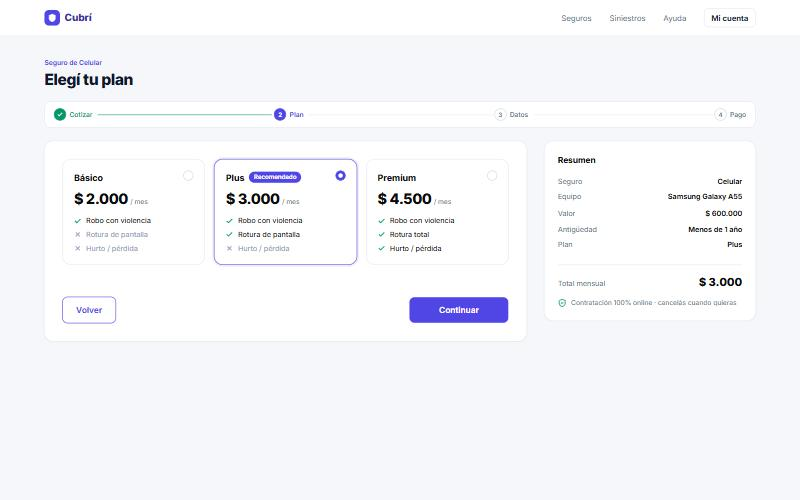
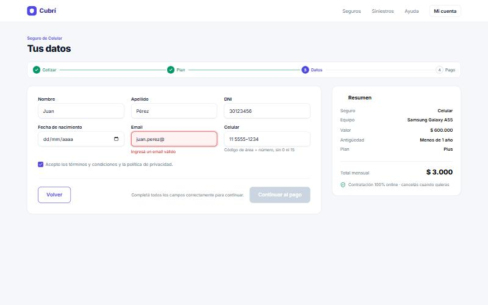
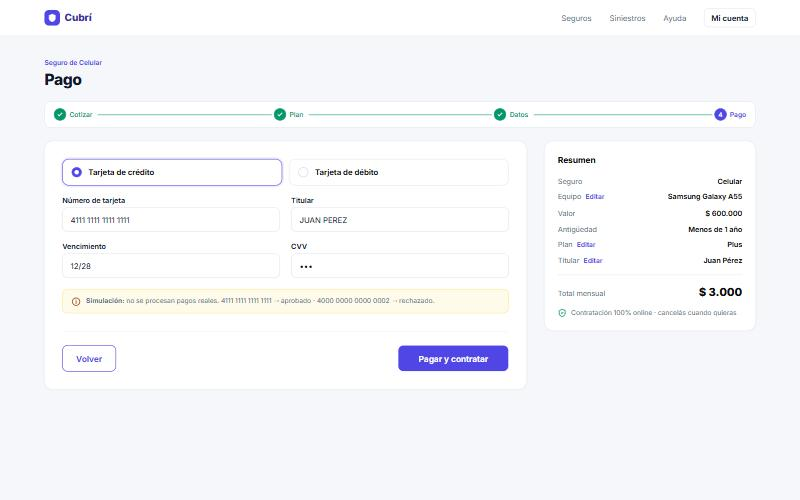
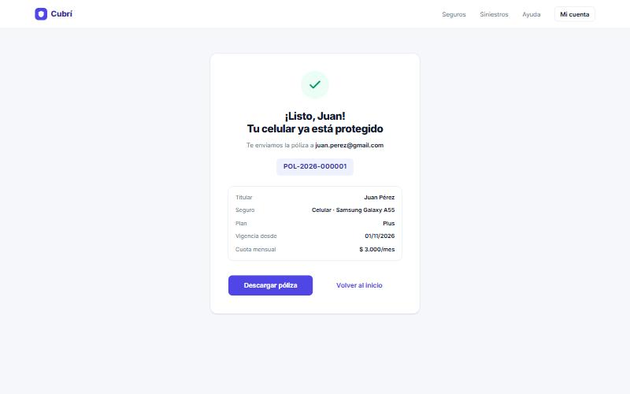

# Cubrí Seguros — Contratación digital de un seguro de celular

Trabajo Práctico N.º 5 · Diseño UX/UI · Licenciatura en Sistemas de Información (2026)

Cubrí Seguros es el front-end de un checkout para contratar un seguro de celular. El usuario elige el producto, cotiza, elige un plan, carga sus datos, paga (de forma simulada) y recibe su número de póliza. Todo funciona en una sola página (`index.html`), en mobile y en desktop, con el mismo código.

> **Alcance:** no hay backend, base de datos ni pagos reales. Los planes salen de un JSON local y el pago es una función que simula la respuesta según el número de tarjeta.

- **Diseño base:** [Figma — Práctica · Contratación Digital de Seguros](https://www.figma.com/design/vJrfOUfiOI7OSeTtRfCloh), páginas *Mobile · 390* y *Desktop · 1440*.
- **Sitio publicado:** [contratacionseguros.vercel.app](https://contratacionseguros.vercel.app/)

---

## Tecnologías

| Tecnología | Uso |
|---|---|
| HTML5 semántico | Una sola página; cada paso es una `<section data-paso>` que se muestra u oculta con `hidden`. |
| Tailwind CSS v4 (CDN `@tailwindcss/browser@4`) | Layout, espaciado y responsive (mobile first, prefijo `lg:`). |
| Basecoat UI 1.1.0 (CDN, solo CSS) | Botones, campos (`.field`), cards, badges y alerts. |
| JavaScript vanilla (módulos ES6) | Estado, navegación, validaciones, cálculo de cuotas y pago simulado. |
| CSS propio (`css/tokens.css`) | Tokens del Figma y ajustes sobre Basecoat (stepper, chips, tarjetas de plan). |
| JSON local (`data/planes.json`) | Planes y tasas, cargados con `fetch()`. |

Sin frameworks, sin TypeScript, sin jQuery y sin librerías de validación.

## Estructura de carpetas

```text
.
├── index.html              # Las 7 pantallas (una <section> por paso)
├── css/
│   └── tokens.css          # Tokens del Figma + ajustes sobre Basecoat
├── data/
│   └── planes.json         # Básico, Plus y Premium (tasa anual y coberturas)
├── js/
│   ├── app.js              # Arranque, eventos y navegación
│   ├── estado.js           # Objeto "solicitud" + funciones para modificarlo
│   ├── render.js           # Pinta cada paso a partir del estado
│   ├── validaciones.js     # Funciones puras: valor -> mensaje de error o null
│   ├── cotizador.js        # calcularCuota(), formato de moneda, carga de planes
│   └── pago.js             # simularPago() y generarPoliza()
├── docs/
│   └── capturas/           # Capturas mobile y desktop
└── README.md
```

## Cómo ejecutarlo localmente

El JSON de planes se carga con `fetch()`, así que **no funciona abriendo el HTML con doble clic** (`file://`). Hace falta un servidor local. Cualquiera de estas opciones sirve:

```bash
npx serve .
```

```bash
python -m http.server 5500
```

O con la extensión **Live Server** de VS Code: clic derecho sobre `index.html` → *Open with Live Server*.

Después abrí `http://localhost:5500` (o el puerto que indique la herramienta).

## Pantallas y funcionalidades

| # | Pantalla | Qué hace |
|---|---|---|
| 01 | Inicio / Catálogo | 4 productos (Celular, Hogar, Bicicleta, Viaje). Solo Celular está habilitado; los otros muestran "Próximamente". El CTA lleva al Paso 1. |
| 02 | Cotizar (Paso 1) | Marca (select), modelo, valor y antigüedad (opción única). "Ver planes" deshabilitado hasta que todo sea válido. Errores en línea al salir del campo. |
| 03 | Elegir plan (Paso 2) | Básico, Plus y Premium con la cuota calculada. Plus preseleccionado con badge "Recomendado". El resumen se actualiza al instante. |
| 04 | Datos personales (Paso 3) | Nombre, apellido, DNI, nacimiento, email, celular y términos. Borde rojo + mensaje por campo. "Continuar al pago" deshabilitado hasta que todo sea válido. |
| 05 | Pago (Paso 4) | Resumen generado desde el estado + crédito/débito, tarjeta, vencimiento, CVV y titular. "Procesando…" durante 1,5 s. |
| 06 | Contratación exitosa | Titular, email, seguro, plan, cuota y número de póliza `POL-AAAA-NNNNNN`. "Volver al inicio" reinicia la solicitud. |
| 07 | Error de pago | Mensaje de rechazo, "Reintentar pago" y "Cambiar medio de pago": ambos vuelven al Paso 4 con todos los datos cargados. |

En todos los pasos el **stepper** muestra cada etapa como completa, activa o pendiente, y **"Volver"** lleva al paso anterior sin perder datos.

### Responsive

| Elemento | Mobile (390 px) | Desktop (1440 px, desde `lg:`) |
|---|---|---|
| Checkout | Una columna | Formulario + resumen lateral de 380 px |
| Resumen | Barra fija arriba del botón (paso 2) y card arriba del formulario (pago) | Card lateral fija |
| Campos | Uno por fila (salvo pares cortos) | 2 o 3 por fila |
| Planes | Apilados | Tres en fila |
| Botones | Ancho completo en un footer fijo; "Volver" con la flecha de la barra superior | "Volver" a la izquierda y "Continuar" a la derecha |
| Inicio | Grilla 2×2 | Hero a la izquierda y grilla a la derecha |

Se probó en 320, 390, 768 y 1440 px sin desbordamiento horizontal.

## Reglas de negocio

```js
cuota = Math.round(valor * tasaAnual / 12 * factorAntiguedad)
```

| Antigüedad | Factor |
|---|---|
| Menos de 1 año | 1,00 |
| 1 a 2 años | 1,10 |
| Más de 2 años | 1,25 |

Casos de prueba (verificados con Node y en la interfaz):

| Valor | Antigüedad | Básico | Plus | Premium |
|---|---|---|---|---|
| $ 600.000 | Menos de 1 año | $ 2.000 | $ 3.000 | $ 4.500 |
| $ 600.000 | 1 a 2 años | $ 2.200 | $ 3.300 | $ 4.950 |
| $ 1.200.000 | Más de 2 años | $ 5.000 | $ 7.500 | $ 11.250 |

Los importes se muestran con `Intl.NumberFormat("es-AR", { style: "currency", currency: "ARS" })` sin decimales.

### Validaciones

| Campo | Regla | Mensaje |
|---|---|---|
| Marca | Obligatoria | Elegí una marca |
| Modelo | 2 a 40 caracteres | Ingresá el modelo del equipo |
| Valor | Entre 100.000 y 2.500.000 | El valor debe estar entre $100.000 y $2.500.000 |
| Antigüedad | Una opción elegida | Indicá la antigüedad |
| Nombre / Apellido | Mínimo 2 letras | Ingresá tu nombre / Ingresá tu apellido |
| DNI | `/^\d{7,8}$/` | El DNI debe tener 7 u 8 números |
| Fecha de nacimiento | Mayor de 18 años | Tenés que ser mayor de edad |
| Email | `/^[^\s@]+@[^\s@]+\.[^\s@]+$/` | Ingresá un email válido |
| Celular | 10 dígitos sin 0 ni 15 (ignora espacios y guiones) | Ingresá 10 dígitos sin 0 ni 15. Ej.: 11 5555-1234 |
| Términos | Tildado | Tenés que aceptar los términos |
| Tarjeta | 16 dígitos (ignora espacios) | Número de tarjeta inválido |
| Vencimiento | MM/AA, mes 01–12 y fecha futura | Vencimiento inválido |
| CVV | 3 dígitos | CVV inválido |
| Titular | Obligatorio | Ingresá el nombre del titular |

## Simulador de pagos

`js/pago.js` reproduce la función de la consigna: espera **1.500 ms** y responde según el número de tarjeta.

| Número de tarjeta | Resultado |
|---|---|
| `4111 1111 1111 1111` | Aprobado → pantalla de éxito |
| `4000 0000 0000 0002` | Rechazado → pantalla de error |
| Cualquier otro número válido de 16 dígitos | Aprobado |

Al presionar **"Pagar y contratar"**: se validan los datos, el botón se deshabilita, muestra "Procesando…" con un spinner, se bloquean los campos y "Volver", y a los 1,5 s se muestra el resultado. Un segundo clic no dispara otro pago.

El número de póliza tiene el formato `POL-AAAA-NNNNNN`: el año actual y un contador de 6 dígitos que se guarda en `localStorage` para no repetir números.

> **Importante:** no uses tarjetas reales, ni siquiera para probar. Solo las de esta tabla.

## Decisiones técnicas

- **Un único estado.** Toda la información vive en el objeto `solicitud` de `js/estado.js` (paso, equipo, plan, titular, pago y póliza). Cada evento modifica el estado y después se llama a las funciones de render. Los precios siempre se calculan con `calcularCuota()` a partir del estado, nunca leyendo textos del DOM.
- **Estado de interfaz separado.** Lo que no es dato de la solicitud (campos ya tocados, pago en curso, planes cargados) vive en objetos aparte (`interfaz`, `catalogo`), para que `solicitud` quede limpio.
- **Validaciones como funciones puras.** Cada función recibe un valor y devuelve un mensaje o `null`. Las de paso completo (`validarEquipo`, `validarTitular`, `validarPago`) devuelven un objeto `{ campo: mensaje }`.
- **Cuándo se muestran los errores.** Se muestran al salir del campo (`focusout`), no mientras se empieza a escribir. Si un campo ya mostró un error, se revalida mientras se corrige. Al intentar avanzar (Enter o clic sobre el botón deshabilitado) se revalida todo el paso, se muestran todos los errores y el foco va al primer campo inválido.
- **Botón deshabilitado con explicación.** Mientras el paso no es válido, el botón está deshabilitado y aparece "Completá todos los campos correctamente para continuar."
- **Un solo resumen.** `renderResumen()` escribe en una única `<aside>`: en desktop es la card lateral y en mobile se muestra arriba del formulario de pago. La barra inferior del paso 2 también se completa desde esa función.
- **Accesibilidad.** Labels asociados, `aria-invalid` y `aria-describedby` en los campos con error, mensajes con `role="alert"`, `aria-current="step"` en el stepper, foco al título de cada paso al navegar, link "Saltar al contenido" y estados hover/focus/disabled visibles.
- **Basecoat y Tailwind.** Los componentes que existen en Basecoat (`.btn`, `.field`, `.card`, `.badge`, `.alert`) se usan tal cual. El stepper, los chips de antigüedad y las tarjetas de plan se armaron con Tailwind y CSS propio. Los ajustes sobre Basecoat están en `css/tokens.css`, fuera de `@layer`, porque los selectores de Basecoat son más específicos.
- **Tokens.** Los colores del Figma se exponen como variables CSS y como utilidades de Tailwind (`bg-primario`, `text-suave`, `border-borde`, etc.) con `@theme inline`. La paleta por defecto de Tailwind v4 no coincide exactamente con los HEX del Figma, por eso no se usa `indigo-600` directamente.
- **Diferencias menores con el Figma.** En el catálogo no se muestra "desde $X/mes" en los productos deshabilitados, porque la consigna pide mostrarlos como "Próximamente". El resumen del pago en mobile también muestra valor y antigüedad del equipo. En la pantalla de éxito se agregaron titular y seguro al detalle, como pide la consigna. Los textos de ejemplo del Figma (Juan Pérez, Galaxy A55, $ 3.000) salen del estado.

## Bonus implementados

1. **Persistencia temporal:** la solicitud se guarda en `localStorage` en cada cambio y sobrevive a un F5. Se limpia al confirmar el pago o con "Volver al inicio". El número de tarjeta y el CVV **nunca** se guardan.
2. **Máscaras de input:** la tarjeta se agrupa de a 4 dígitos y el vencimiento agrega la barra automáticamente. El DNI acepta pegar "30.123.456" y lo limpia.
3. **Editar desde el resumen:** en el pago, los links "Editar" llevan a Equipo, Plan o Titular; el botón cambia a "Guardar y volver al pago" y regresa directo al Paso 4.
4. **Microinteracciones:** transición de entrada entre pantallas (respeta `prefers-reduced-motion`), estados hover/focus en chips y tarjetas, y spinner en el pago.
5. **Descargar póliza:** genera un `.txt` con el detalle de la póliza simulada.

## Capturas

Capturas tomadas del sitio funcionando en un navegador real.

### Mobile (390 px)

| Inicio | Elegir plan | Pago | Error de pago |
|---|---|---|---|
|  |  |  |  |

### Desktop (1440 px)

| Inicio | Elegir plan |
|---|---|
|  |  |

| Datos personales (con error) | Pago |
|---|---|
|  |  |

| Contratación exitosa |
|---|
|  |

## Sitio desplegado

El proyecto se encuentra publicado en Vercel y se puede acceder desde el siguiente enlace:

[Ver Cubrí Seguros](https://contratacionseguros.vercel.app/)

## Checklist de la consigna

- [x] Las 7 pantallas existen y se ven bien en 390 px y en 1440 px.
- [x] Los 3 casos de prueba de la sección 5.1 dan exactamente el valor esperado.
- [x] No se puede avanzar con datos inválidos y cada error tiene su mensaje.
- [x] "Volver" conserva los datos en todos los pasos.
- [x] La tarjeta 4000 0000 0000 0002 lleva al error y "Reintentar" vuelve al pago con todo cargado.
- [x] La póliza tiene formato `POL-AAAA-NNNNNN`.
- [x] No hay errores en la consola del navegador.
- [x] El sitio está publicado y el README tiene la URL.
